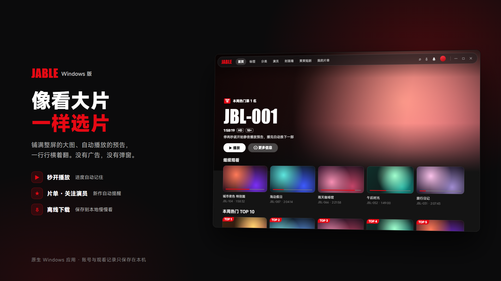
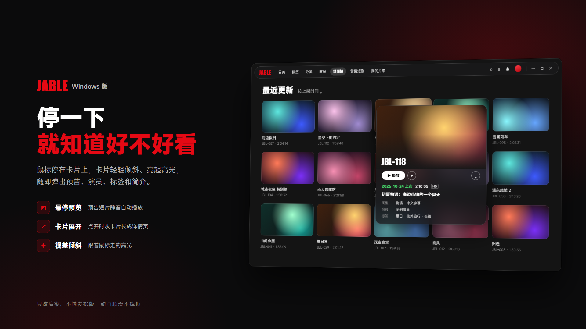
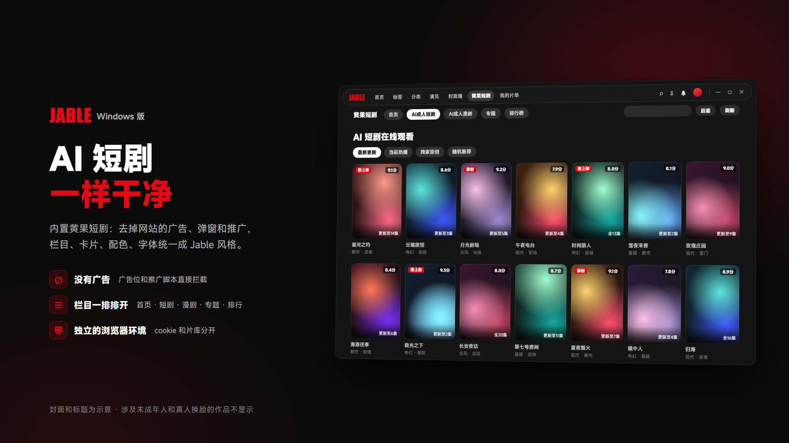
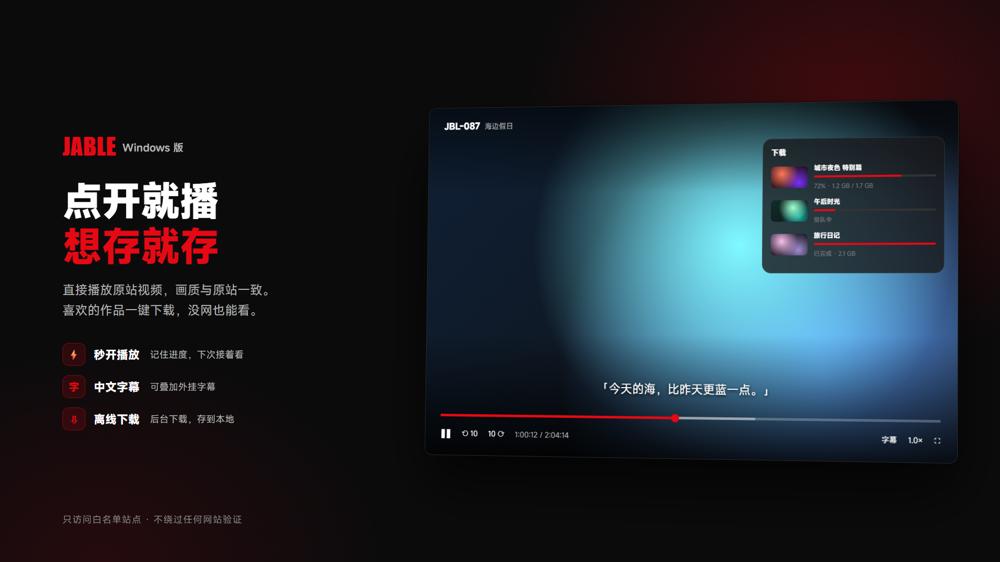

# Jable · Windows

一个原生的 Windows 影片浏览 / 播放客户端：把 Jable 的影片和 Netflav、AV01、R18.dev 的作品资料整合到一个干净、无广告、像流媒体应用一样的界面里。

安卓版：[Jable-Android](https://github.com/QkzzZzZz/Jable-Android)



| | |
|---|---|
|  |  |
|  | |

<sub>宣传图里的封面、标题和番号都是示意。</sub>

## 功能

- **首页**：铺满整屏的大图轮播（停两秒自动静音播放预告），继续观看、猜我喜欢、最近更新、本周热门 TOP 10、新片上市，可把常看的标签固定到首页
- **浏览**：搜索、分类、标签、演员目录、封面墙
- **悬停卡**：鼠标停在卡片上，卡片轻轻倾斜、亮起高光，随即弹出预告、演员、标签和简介
- **作品详情**：点开时从卡片「长」成详情弹窗；番号、发行日、演员、标签、中文简介、剧照、相关作品
- **播放**：倍速、续播、小窗置顶、快捷键、外挂字幕（按番号记住字幕偏移）
- **下载**：后台下载到本地，没网也能看
- **观看画像**：观看统计、口味偏好、演员偏好、猜我喜欢——全部在本机计算
- **关注**：关注演员，常驻托盘定时检查，有新作弹出通知
- **黄果短剧**：内置 AI 短剧站点，去掉网站自己的广告、弹窗和推广，栏目、卡片、配色、字体统一成 Jable 风格；涉及未成年人和真人换脸的作品不显示
- **界面**：深色毛玻璃、MiSans 字体、Netflix 式的行与大图、圆角卡片和顺滑动画；顶栏放不下的栏目自动收进「更多」

## 安装

在 [Releases](../../releases) 下载 `Jable-Setup-<版本>.exe` 安装。安装包自带 .NET 运行时，不需要管理员权限。

## 编译

需要 Windows 10/11 和 [.NET 8 SDK](https://dotnet.microsoft.com/download)。界面字体 MiSans 不放在仓库里，第一次先下载：

```powershell
powershell -File tools\get-fonts.ps1         # 从小米官网下载 MiSans（不下载也能编译，界面回落到微软雅黑）
dotnet run --project src/JableLens.App       # 运行
dotnet test                                  # 测试
powershell -File installer\build.ps1         # 打安装包（需要 Inno Setup 6）
```

## 目录结构

```
src/JableLens.Core     数据层：站点解析、字幕、观看记录、推荐、下载
src/JableLens.App      WPF 界面、播放器、嵌入网站
tests/                 单元测试（样本是真实页面）
tools/                 命令行调试工具、字体下载脚本
installer/             安装包脚本
docs/                  技术说明
promo/                 宣传图源文件
```

实现细节（读取页面、播放原理、嵌入网站的整理方式、调试参数）见 [docs/技术说明.md](docs/技术说明.md)。

## 隐私

- 只访问白名单内的站点，广告和统计请求一律拦截
- 账号、cookie、观看记录只保存在本机，不发送给任何第三方
- 不伪造浏览器指纹，不破解人机验证

## 第三方组件

[hls.js](https://github.com/video-dev/hls.js)（Apache-2.0）、[AngleSharp](https://github.com/AngleSharp/AngleSharp)（MIT）、[WebView2](https://www.nuget.org/packages/Microsoft.Web.WebView2)、[Windows Community Toolkit](https://github.com/CommunityToolkit/WindowsCommunityToolkit)（MIT）；界面字体 [MiSans](https://hyperos.mi.com/font/)（小米，免费商用）。

## 免责声明

1. **仅限成年人**：本项目涉及成人内容，仅供已满 18 周岁（或所在地法定成年年龄）的用户使用。所在地区禁止此类内容的，请勿下载、编译或使用。
2. **不提供任何内容**：本项目不存储、不上传、不分发任何影片、图片或其他媒体内容，所有内容均来自第三方网站，其版权与合法性由对应网站及权利人负责。
3. **嵌入网站**：内置的第三方网站由其运营方提供，本项目只做显示上的整理（隐藏广告、调整样式），不修改其内容。
4. **不绕过保护措施**：本项目不破解人机验证，不伪造浏览器指纹，不绕过付费墙或 DRM。
5. **仅供学习交流**：代码仅用于学习桌面开发、网页解析和流媒体播放技术，请勿用于商业用途。
6. **风险自负**：使用本项目产生的一切后果（包括违反当地法律法规、第三方网站服务条款、版权纠纷等）由使用者自行承担，作者不承担任何责任。
7. **与相关网站无关**：本项目与文中提到的任何网站均无关联，也未获其授权；相关名称和商标归各自所有者所有。
8. **侵权处理**：权利人如认为本项目侵犯其合法权益，请通过 Issues 联系，核实后会及时下架相关内容。

本软件按「现状」提供，不附带任何担保。下载、编译或使用本项目即表示同意以上条款。

## 许可证

[MIT](LICENSE)
